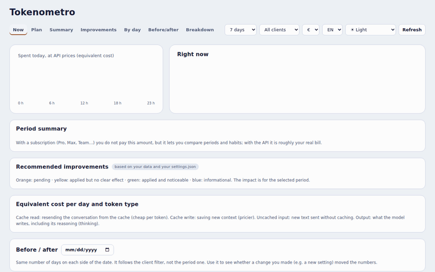
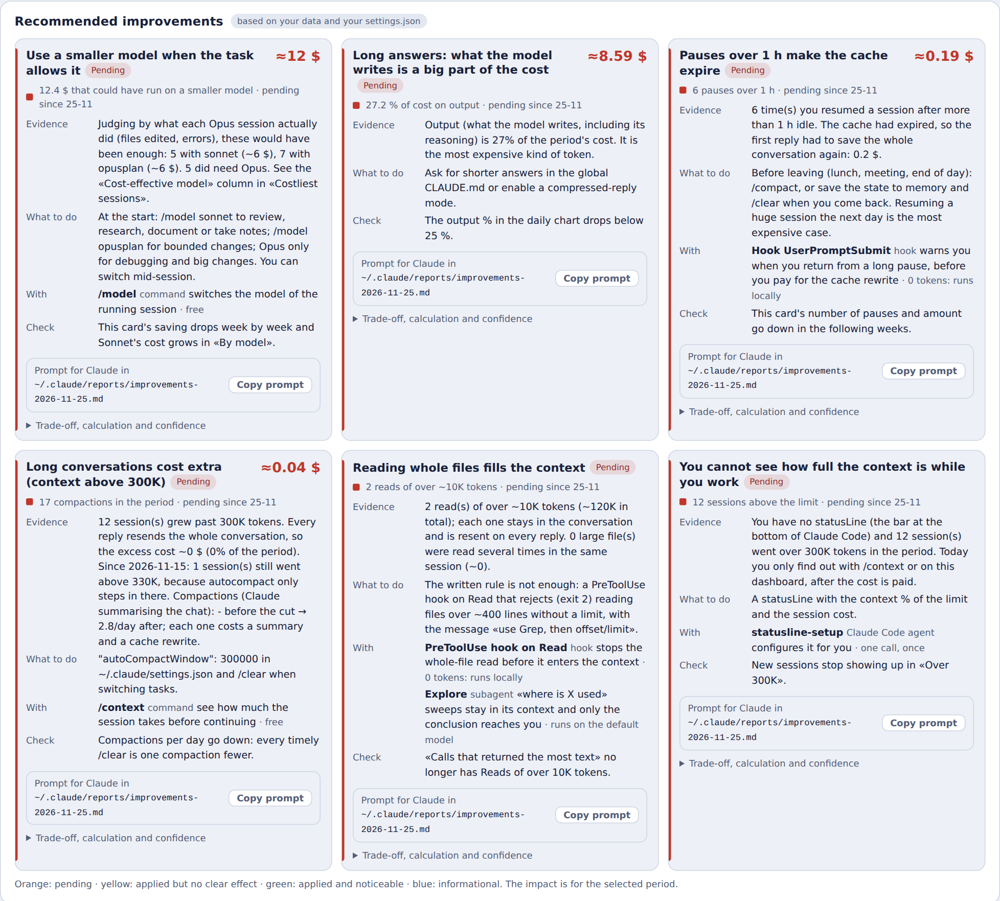
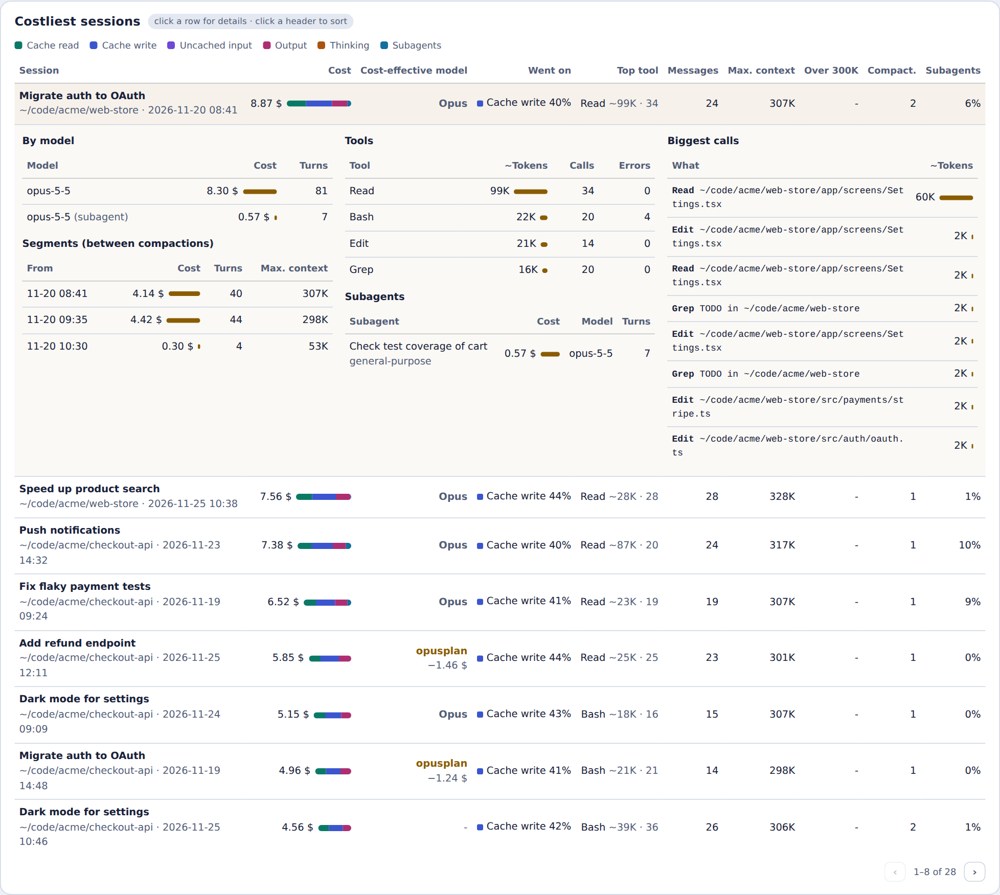

<h1 align="center">Tokenómetro</h1>

<p align="center">
  <b>Mira cuánto cuestan tus sesiones de Claude Code, en qué se van los tokens y qué cambiar para gastar menos.</b><br>
  Un solo fichero de Python · sin dependencias · nada sale de tu equipo · inglés y español · claro y oscuro
</p>

<p align="center">
  <a href="LICENSE"></a>
  
  
  
  <br><a href="README.md">Read in English</a>
</p>

<p align="center">
  
</p>

## Pruébalo en 10 segundos

```bash
git clone https://github.com/Jaferdi/tokenometro.git && cd tokenometro
python3 demo.py --lang es --currency EUR   # abre http://127.0.0.1:7879 con un mes de sesiones inventadas
```

La demo funciona en una carpeta temporal con datos inventados: no lee tus registros, no toca `~/.claude` y lo borra todo al pulsar Ctrl+C. Si te convence, [instálalo](#instalación).

## Qué te da

| | |
|---|---|
| **Hoy y ahora mismo** | El gasto de hoy en un cuentakilómetros y cada sesión abierta con el tamaño de su contexto, lo que lleva gastado, las compactaciones y la parte del plan que se ha llevado. |
| **Tu plan** | % de la ventana de 5 horas y de la semana, cuándo se reinician, el tope estimado en € o $ y si al ritmo actual lo agotarás antes de que se reinicie. |
| **Mejoras recomendadas** | Tarjetas hechas con *tus* datos y *tu* `settings.json`: qué cambiar, cuánto pesa, cómo comprobar que ha funcionado y un prompt listo para pegarle a Claude. |
| **Sesiones** | Coste de cada sesión separado en entrada, salida, lecturas y escrituras de caché; el modelo más barato que habría bastado; tramos entre compactaciones, subagentes y las llamadas a herramientas más gordas. |
| **Presupuesto e informes** | Pon un límite diario, semanal o mensual y te avisa al 80 % y al 100 % en el panel y en la línea de estado. Descarga un CSV mensual por sesión o por cliente para compartirlo o repercutirlo. |
| **Antes / después** | Elige la fecha de un cambio (un ajuste nuevo, una costumbre nueva) y compara el coste por mensaje, el contexto y las compactaciones a cada lado. |

<table>
  <tr>
    <td width="50%">
      <picture>
        <source media="(prefers-color-scheme: dark)" srcset="docs/recommendations-dark.png">
        
      </picture>
    </td>
    <td width="50%">
      <picture>
        <source media="(prefers-color-scheme: dark)" srcset="docs/sessions-dark.png">
        
      </picture>
    </td>
  </tr>
</table>

> Sin relación con Anthropic. Claude y Claude Code son marcas de Anthropic.

## Privacidad

- Solo lee `~/.claude/projects/**/*.jsonl` (y, si existe, la última lectura del plugin sub-meter).
- Escucha en `127.0.0.1`: el panel no es accesible desde fuera de tu equipo.
- No se conecta a internet ni envía nada. Todo queda en `~/.local/share/tokenometro/usage.db` (SQLite).
- En «Llamadas más gordas» enmascara lo que parezca un secreto, pero el panel muestra trozos de tus comandos y rutas: no lo compartas en capturas sin mirarlo.

## Requisitos

Python 3.8 o superior, sin dependencias. Linux, macOS, WSL o Windows.

## Instalación

**Como plugin de Claude Code** (cualquier sistema), dentro de Claude Code:

```
/plugin marketplace add Jaferdi/tokenometro
/plugin install tokenometro@tokenometro
```

El plugin levanta el panel en cada sesión y mantiene su código al día en la carpeta de datos. Los plugins no pueden poner la statusLine, así que para ver el % del plan añádela tú (ver [Uso del plan](#uso-del-plan-5-horas-y-semana)).

**Con el instalador**:

```bash
git clone https://github.com/Jaferdi/tokenometro.git && cd tokenometro
python3 install.py               # instala, registra el arranque automático y lo levanta (en Windows: py install.py)
python3 install.py --statusline  # además usa statusline.py para ver el % del plan
```

`bash install.sh` sigue funcionando y hace lo mismo. El instalador:

1. Copia los ficheros a `~/.local/share/tokenometro` (en Windows, `%LOCALAPPDATA%\tokenometro`).
2. Añade en `~/.claude/settings.json` un hook `SessionStart` que levanta el panel al abrir Claude Code. Antes guarda una copia: `settings.json.bak-tokenometro-<fecha>`.
3. Lee el histórico (la primera vez tarda un poco) y abre el servidor en http://127.0.0.1:7878.

Si ya tenías la versión anterior en `~/.local/share/claude-tokens`, copia datos y configuración y cambia el hook.

Para quitarlo: `python3 ~/.local/share/tokenometro/install.py --uninstall` (quita el hook y la statusLine propia; los datos se quedan hasta que borres la carpeta).

## Qué enseña el panel

- **Hoy y ahora mismo**: gasto del día (odómetro), sesiones abiertas con su contexto, coste acumulado, compactaciones y, si hay lectura del plan, qué parte del 5 h y de la semana se ha llevado cada una.
- **Plan**: % usado de la ventana de 5 horas y de la semana, cuándo se reinicia y un techo estimado en € o $ equivalentes (ver más abajo).
- **Mejoras recomendadas**: tarjetas con lo que conviene cambiar, cuánto pesa y cómo comprobarlo.
- **Sesiones**: coste por sesión desglosado (entrada, salida, lectura y escritura de caché), el modelo más rentable para cada una, dónde se fue el gasto y la herramienta que más texto metió. Pulsando una fila sale el detalle: tramos entre compactaciones, subagentes y llamadas más gordas.
- **Presupuesto**: lo gastado frente a tus límites de día, semana y mes, con un aviso junto al título a partir del 80 %.
- **Por modelo y por cliente**, con un informe mensual en CSV por sesión o por cliente, y **Antes / después** de una fecha para medir si un cambio de configuración sirvió.

Arriba se elige periodo, cliente, moneda (€ o $), idioma (inglés o castellano) y tema (sistema, claro u oscuro). Las tablas van paginadas.

### «€ eq.» / «$ eq.»

Es lo que costarían esos tokens a tarifa API (`prices.json`). Con suscripción no pagas eso, pero sirve para comparar sesiones y ver qué pesa. Con API es, aproximadamente, tu factura: no se modelan el modo rápido (cuesta el doble), Batch ni Haiku 5.5 por encima de 100K tokens de prompt. En Bedrock, Vertex o Foundry cada proveedor pone su precio: ajusta `prices.json`. Los cálculos se hacen en dólares, que es la tarifa oficial, y se pasan a euros al mostrarlos con el cambio de `prices.json`.

## Mejoras recomendadas: cómo se calculan y cómo evolucionan

Cada tarjeta sale de una regla que cruza tus datos del periodo con tu configuración real (`settings.json`, hooks y plugins activos). Solo aparece si la regla tiene algo que decir. Lleva:

- **Estado**: *pendiente* (no está aplicado), *sin efecto claro* (está aplicado pero los datos no mejoran), *bien* (aplicado y se nota) o *informativa*.
- **Impacto**: importe aproximado del periodo y cómo se ha calculado («Contrapartida, cálculo y confianza»).
- **Métrica e historial**: cada hora se guarda una foto diaria de todas las tarjetas (`recs_hist`). De ahí salen los cuadritos de los últimos 14 días, «pendiente desde…» o «bien desde…» y la tendencia frente a hace 7 días. Si una tarjeta cambia mientras miras el panel, parpadea.
- **Antes / después**: algunas reglas comparan con la fecha de corte. Hasta tener 7 días desde el corte la tarjeta sale «En observación», porque con menos días el tipo de tarea pesa más que el cambio.
- **Con qué**: herramientas o ajustes que existen y compensan para resolverlo.
- **Prompt**: el texto para pedírselo a Claude se guarda en `~/.claude/reports/mejoras-AAAA-MM-DD.md` (`improvements-…` en inglés) y se copia con «Copiar prompt».

Reglas actuales: contexto demasiado grande y compactaciones, retomar sesiones tras pausas largas (reescribe la caché), subagentes con Opus, lecturas de ficheros enormes, ver el contexto en la barra de estado (solo si no tienes ya statusLine o un plugin que lo enseñe), salida del modelo (solo si pasa del 25 % del coste) y modelo rentable.

Límites: son heurísticas sobre tus registros. No saben si una sesión necesitaba de verdad más contexto o un modelo mayor; dicen dónde mirar.

## Modelo rentable por sesión

Para cada sesión con Opus mira qué hizo:

| Si… | Sugiere |
|---|---|
| no editó código, ≤ 10 turnos y costó menos de 2 $ | Haiku |
| no editó código | Sonnet |
| editó de 1 a 9 ficheros de código con menos de 5 errores de Bash | opusplan (Opus planifica, Sonnet ejecuta) |
| lo demás | Opus estaba bien |

Las ediciones de documentación (`.md`, `.json`, `.yaml`…) no cuentan como código. El ahorro es una cota alta: los mismos tokens al precio del modelo menor, aunque un modelo menor puede necesitar más turnos.

## Uso del plan (5 horas y semana)

El % del plan solo existe con suscripción (Pro, Max, Team…): con API no hay límites de 5 horas ni semanales y esta parte enseña solo lo gastado. El % no está en los registros. Claude Code lo recibe de Anthropic y solo se lo pasa a la statusLine y a los plugins. El tokenómetro lo toma de:

1. **El plugin sub-meter**, si lo tienes: guarda su última lectura en `~/.claude/plugins/store/sub-meter_*.json`.
2. **`statusline.py`**, incluido aquí: lee el JSON que Claude Code manda a la statusLine (`rate_limits`) y lo deja en `~/.local/share/tokenometro/plan.json`. Se activa con `install.py --statusline`, o a mano en `~/.claude/settings.json`: `"statusLine": {"type": "command", "command": "python3 \"$HOME/.local/share/tokenometro/statusline.py\""}`. Si ya tienes otra statusLine, encadénala:

   ```
   python3 "$HOME/.local/share/tokenometro/statusline.py" --tee | <tu comando actual>
   ```

Usa la lectura más reciente de las dos. Sin ninguna, el panel enseña solo lo gastado en las últimas 5 horas y 7 días.

**Techo estimado**: cada lectura se guarda junto a lo gastado en esa ventana. El techo es la mediana de *gastado × 100 / %* (lecturas con al menos un 10 %). Es aproximado: el % incluye lo que uses en claude.ai o en otro equipo, y Anthropic no publica cómo pondera cada modelo.

## Configuración

Todo vive en `~/.local/share/tokenometro/`. Tras editar algo, reinicia (ver más abajo).

### `clients.json`

Agrupa sesiones por cliente según la carpeta donde trabajaste (gana la primera ruta que coincida). Parte de `clients.example.json`:

- `clients`: nombre → lista de fragmentos de ruta.
- `cut` (opcional): fecha AAAA-MM-DD del cambio que quieres medir en «Antes / después». Por defecto, hace 7 días.

- `budget` (opcional): límites por `day` (día), `week` (desde el lunes) y `month` (mes), en `currency` (`USD` por defecto, o `EUR`). El panel avisa desde el 80 % y la línea de estado de `statusline.py` añade «budget today 92%». También vale `presupuesto` con `dia`, `semana`, `mes` y `moneda`.

```json
"budget": {"day": 30, "week": 150, "month": 600, "currency": "EUR"}
```

Siguen valiendo los nombres en castellano de versiones anteriores (`clientes.json`, `clientes`, `corte`).

### `prices.json`

Precio por millón de tokens en dólares (tarifa API oficial) de cada modelo actual y de los anteriores (Fable, Mythos, Opus, Sonnet y Haiku): entrada, salida, lectura de caché y escritura de caché a 5 minutos y a 1 hora. Se busca el nombre dentro del id del modelo y gana el más largo, así que `claude-opus-5` no se confunde con `claude-opus-5-5` y valen los prefijos de Bedrock o Vertex. `_default` se usa con modelos que no estén en la lista. Revísalo cuando Anthropic cambie precios o saque modelos.

`_currency` controla los euros:

```json
"_currency": {"default": "EUR", "eur_per_usd": 0.91, "date": "2026-11-19"}
```

El tipo de cambio se actualiza a mano: el tokenómetro no se conecta a nada. Si al actualizar desde una versión anterior tu `prices.json` no tiene `_currency`, el panel solo ofrecerá dólares; cópialo del repo.

### Variables de entorno

| Variable | Para qué | Por defecto |
|---|---|---|
| `TOKENOMETRO_PORT` | Puerto del panel | 7878 |
| `TOKENOMETRO_COST_WARN` | Avisa cuando una sesión pasa de este importe (en $) | 50 |
| `TOKENOMETRO_CUT` | Fecha de corte de «Antes / después» | la de `clients.json` o hace 7 días |
| `TOKENOMETRO_CURRENCY` | `EUR` o `USD` por defecto | la de `prices.json` |
| `TOKENOMETRO_LANG` | `en` o `es` por defecto | `en` |
| `TOKENOMETRO_NO_START` | `1` para que el instalador no lo arranque | |

Siguen valiendo los nombres antiguos `CLAUDE_TOKENS_*`.

## Uso por consola

```bash
python3 ~/.local/share/tokenometro/tracker.py            # servidor (lo que hace el hook)
python3 ~/.local/share/tokenometro/tracker.py ingest     # lee lo nuevo y saca un resumen
python3 ~/.local/share/tokenometro/tracker.py backfill   # rellena datos de herramientas del histórico (una vez)
python3 ~/.local/share/tokenometro/tracker.py report 2026-11 --by client --cur EUR   # CSV mensual por la salida estándar
```

`report` admite `[AAAA-MM]` (por defecto el mes actual), `--by session|client`, `--client NOMBRE` y `--cur USD|EUR`. El mismo CSV está en el panel, en la tarjeta *Por cliente*.

Reiniciar el servidor (solo lo para si es Tokenometro):

```bash
python3 ~/.local/share/tokenometro/start.py --restart
```

## Ficheros

| Fichero | Qué es |
|---|---|
| `tracker.py` | Lector, base de datos, reglas y panel (HTML incluido) |
| `start.py` | Lo levanta en segundo plano si no está ya corriendo (`start.sh` lo llama) |
| `statusline.py` | statusLine opcional que guarda el % del plan |
| `install.py` | Instalar, actualizar y desinstalar (`install.sh` lo llama) |
| `.claude-plugin/`, `hooks/` | Plugin de Claude Code |
| `demo.py` | Probarlo con datos inventados, sin instalar nada |
| `usage.db` | Datos (se regenera desde los registros si lo borras) |
| `plan.json` | Última lectura del plan de `statusline.py` |
| `tracker.log` | Log del servidor |

## Licencia

MIT. Ver [LICENSE](LICENSE). Para colaborar, [CONTRIBUTING.md](CONTRIBUTING.md).
