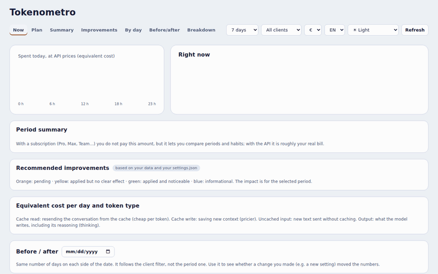
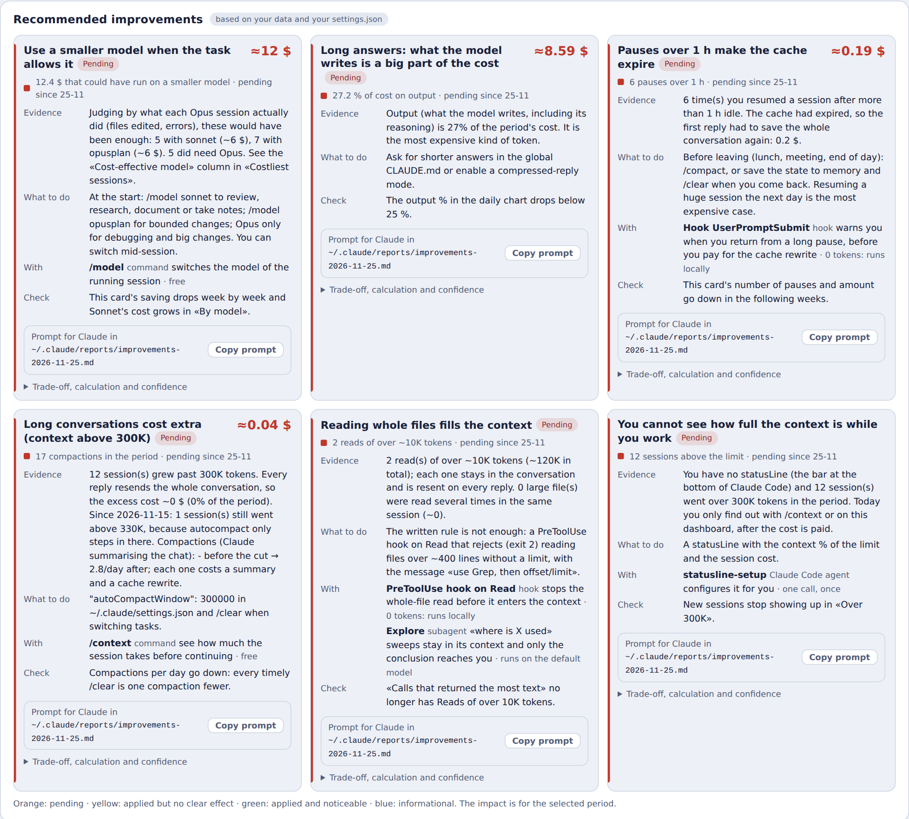
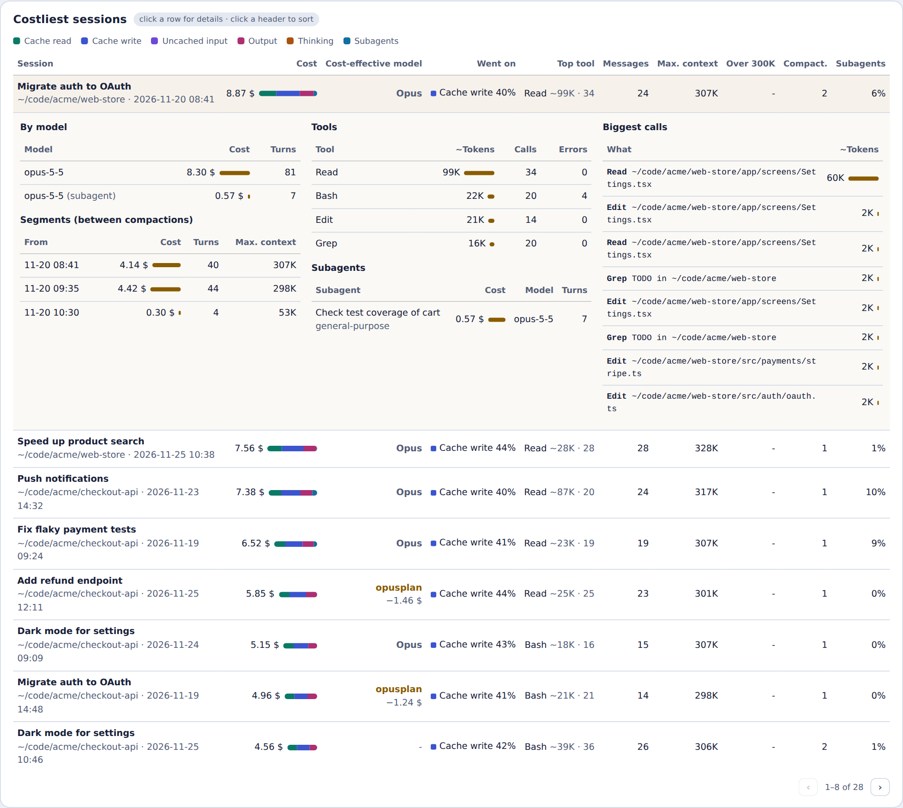

<h1 align="center">Tokenometro</h1>

<p align="center">
  <b>See what your Claude Code sessions cost, where the tokens go, and what to change to spend less.</b><br>
  One Python file · no dependencies · your data stays on your machine · English &amp; Spanish · light &amp; dark
</p>

<p align="center">
  <a href="LICENSE"></a>
  
  
  
  <br><a href="README.es.md">Leer en español</a>
</p>

<p align="center">
  
</p>

## Try it in 10 seconds

```bash
git clone https://github.com/Jaferdi/tokenometro.git && cd tokenometro
python3 demo.py        # opens http://127.0.0.1:7879 with a month of made-up sessions
```

The demo runs in a temporary folder with invented data: it doesn't read your logs, doesn't touch `~/.claude` and deletes everything when you press Ctrl+C. When you like it, [install it](#install).

## What you get

| | |
|---|---|
| **Today and right now** | Today's spend on a rolling odometer, and every open session with its context size, running cost, compactions and the share of your plan it took. |
| **Your plan** | % of the 5-hour window and of the week, when it resets, the estimated ceiling in $ or €, and whether you'll run out before it resets at your current pace. |
| **Recommended improvements** | Cards built from *your* data and *your* `settings.json`: what to change, how much it weighs, how to check it worked, and a ready-to-paste prompt for Claude. |
| **Sessions** | Cost per session split into input, output, cache reads and writes; the cheapest model that would have done the job; segments between compactions, subagents and the biggest tool calls. |
| **By branch / task** | Cost per git branch. If the branch name carries a ticket (`feature/7067`, `fix/ABC-123`), all the repos you touched for it add up into one task; if not, you still get cost per branch. |
| **Fixed cost per session** | What every session carries before you type anything: system prompt, built-in tools, each MCP server, your CLAUDE.md, memory and skills. How much it cost in the period, and a card when an MCP server is loaded everywhere but hardly used. |
| **Weekly summary** | Every Monday a Markdown file in `~/.claude/reports/` with last week's spend against the week before, top sessions and tasks, fixed cost and recommendations that changed. |
| **Reports** | A monthly CSV per session or per client, to share or to bill a client, from the dashboard or the command line. |
| **Before / after** | Pick the date of a change (a new setting, a new habit) and compare cost per message, context and compactions on each side. |

<table>
  <tr>
    <td width="50%">
      <picture>
        <source media="(prefers-color-scheme: dark)" srcset="docs/recommendations-dark.png">
        
      </picture>
    </td>
    <td width="50%">
      <picture>
        <source media="(prefers-color-scheme: dark)" srcset="docs/sessions-dark.png">
        
      </picture>
    </td>
  </tr>
</table>

The top bar picks period, client, currency (€ or $), language (English or Spanish) and theme. Click a session for its details.

> Not affiliated with Anthropic. Claude and Claude Code are trademarks of Anthropic.

## Install

Needs Python 3.8 or later and nothing else. Linux, macOS, WSL or Windows.

**As a Claude Code plugin** (any OS), inside Claude Code:

```
/plugin marketplace add Jaferdi/tokenometro
/plugin install tokenometro@tokenometro
```

The plugin starts the dashboard with every session and keeps its code up to date in the data folder. Plugins can't set the statusLine, so to see plan usage % add it yourself (see [Plan usage](#plan-usage-5-hours-and-week)).

**With the installer**:

```bash
git clone https://github.com/Jaferdi/tokenometro.git && cd tokenometro
python3 install.py               # installs, registers auto-start and launches it (on Windows: py install.py)
python3 install.py --statusline  # also uses statusline.py to see plan usage %
```

`bash install.sh` still works and does the same. The installer:

1. Copies the files to `~/.local/share/tokenometro` (on Windows, `%LOCALAPPDATA%\tokenometro`).
2. Adds a `SessionStart` hook to `~/.claude/settings.json` that starts the dashboard when you open Claude Code. It backs up the file first: `settings.json.bak-tokenometro-<date>`.
3. Reads your history (the first run takes a while) and starts the server at http://127.0.0.1:7878.

**With pipx**:

```bash
pipx install git+https://github.com/Jaferdi/tokenometro
tokenometro install              # same as install.py; add --statusline for plan usage %
```

The `tokenometro` command also does `open`, `restart`, `report`, `digest`, `demo` and `uninstall` (`tokenometro help`).

**Updates**: the dashboard shows *vX.Y available* next to the title when there is a new release, with the command for the way you installed it: `claude plugin update tokenometro@tokenometro`, `git pull && python3 install.py` or `pipx upgrade tokenometro && tokenometro install`. To hear about releases by email, *Watch → Custom → Releases* on GitHub.

If you had the earlier version in `~/.local/share/claude-tokens`, it copies your data and settings and swaps the hook.

To remove it: `python3 ~/.local/share/tokenometro/install.py --uninstall` (removes the hook and our statusLine; data stays until you delete the folder).

## Privacy

- It only reads `~/.claude/projects/**/*.jsonl` (and, if present, the last reading of the sub-meter plugin).
- It listens on `127.0.0.1`: the dashboard is not reachable from outside your machine.
- Your data never leaves your machine: everything stays in `~/.local/share/tokenometro/usage.db` (SQLite).
- Its only request to the internet: once a day it asks GitHub which release is the latest (`api.github.com/repos/Jaferdi/tokenometro/releases/latest`), sending nothing of yours. GitHub sees your IP, as with any visit. Turn it off with `TOKENOMETRO_UPDATE_CHECK=0`.
- "Biggest calls" masks anything that looks like a secret, but the dashboard does show parts of your commands and paths: check before sharing screenshots.

## What "$ eq." means

What those tokens would cost at API rates (`prices.json`). On a subscription you don't pay that, but it lets you compare sessions and see what weighs most. On the API it is roughly your bill: fast mode (twice the price), Batch, and Haiku 5.5 above 100K prompt tokens are not modelled. On Bedrock, Vertex or Foundry each provider sets its own prices: adjust `prices.json`. Calculations are done in dollars, the official rate, and converted to euros for display using the rate in `prices.json`.

## Recommended improvements: how they are built and how they evolve

Each card comes from a rule that crosses your data for the period with your actual configuration (`settings.json`, enabled hooks and plugins). It only shows up when the rule has something to say. Each card has:

- **Status**: *to do* (not applied), *no clear effect* (applied but the data isn't improving), *good* (applied and it shows) or *info*.
- **Impact**: rough amount for the period and how it was calculated.
- **Metric and history**: every hour a daily snapshot of all cards is saved (`recs_hist`). That feeds the squares for the last 14 days, "to do since…" or "good since…", and the trend versus 7 days ago. If a card changes while the dashboard is open, it flashes.
- **Before / after**: some rules compare against the cut-off date. Until there are 7 days since the cut-off the card shows "Under observation", because with fewer days the kind of task weighs more than the change.
- **With what**: existing tools or settings that are worth it to fix it.
- **Apply**: when the fix is a single setting (`autoCompactWindow`, `CLAUDE_CODE_SUBAGENT_MODEL`), the card has an *Apply* button. It saves a dated backup of `~/.claude/settings.json`, changes only that key and, from the next day on, shows the card's metric before and after. *Undo* puts back the previous value, unless you changed it by hand since.
- **Only what holds up**: a finding is recommended once it shows up on 3 of the last 7 days and saves enough for *your* spend (1% of it a week, between 0.25 and 2 USD). Until then it waits under *Under study*, saying what it is missing. *Not for me* hides a card until its cost doubles; *Restore* brings it back.
- **Prompt**: the text to ask Claude to do it is saved to `~/.claude/reports/improvements-YYYY-MM-DD.md` (`mejoras-…` in Spanish) and copied with "Copy prompt".

Current rules: oversized context and compactions, resuming sessions after long pauses (rewrites the cache), subagents running on Opus, reading huge files, showing context in the status line (only if you don't already have a statusLine or a plugin showing it), model output (only above 25% of cost), cost-effective model, MCP servers loaded but barely used, the cache rebuilt without a pause (by cause: model switch, context trimmed near the limit, or no visible cause) huge tool outputs carried turn after turn, whether the 5-minute or the 1-hour cache pays off for how you pause (simulated on your own requests, can be applied with one click), a tool failing three or more times in a row, and a global CLAUDE.md that is too heavy for something read on every turn.

Limits: these are heuristics over your logs. They can't tell whether a session really needed more context or a bigger model; they tell you where to look.

## Cost-effective model per session

For each session that used Opus, it looks at what the session did:

| If… | Suggests |
|---|---|
| no code edits, ≤ 10 turns and under $2 | Haiku |
| no code edits | Sonnet |
| 1 to 9 code files edited with fewer than 5 Bash errors | opusplan (Opus plans, Sonnet executes) |
| anything else | Opus was right |

Edits to documentation (`.md`, `.json`, `.yaml`…) don't count as code. The saving is an upper bound: the same tokens at the smaller model's price, although a smaller model may need more turns.

## Plan usage (5 hours and week)

Plan usage only exists on subscriptions (Pro, Max, Team…): the API has no 5-hour or weekly limits, so this card just shows what was spent. The % is not in the logs. Claude Code receives it from Anthropic and only passes it to the statusLine and to plugins. Tokenometro reads it from:

1. **The sub-meter plugin**, if you have it: it saves its last reading in `~/.claude/plugins/store/sub-meter_*.json`.
2. **`statusline.py`**, included here: it reads the JSON Claude Code sends to the statusLine (`rate_limits`) and saves it to `~/.local/share/tokenometro/plan.json`. Enable it with `install.py --statusline`, or by hand in `~/.claude/settings.json`: `"statusLine": {"type": "command", "command": "python3 \"$HOME/.local/share/tokenometro/statusline.py\""}`. If you already have a statusLine, chain it:

   ```
   python3 "$HOME/.local/share/tokenometro/statusline.py" --tee | <your current command>
   ```

On its own, `statusline.py` prints `5h 46%  week 20%`, and adds `· runs out 16:40` when, at the pace since the window opened, you would hit 100% before it resets (`TOKENOMETRO_LANG=es` prints it in Spanish).

It uses whichever reading is newer. With neither, the dashboard only shows what was spent in the last 5 hours and 7 days.

**Estimated ceiling**: each reading is stored together with the spend in that window. The ceiling is the median of *spent × 100 / %* (readings of at least 10%). It's approximate: the % includes what you use on claude.ai or on another machine, and Anthropic doesn't publish how each model is weighted.

## Configuration

Everything lives in `~/.local/share/tokenometro/`. Restart after editing (see below).

### `clients.json`

Groups sessions by client based on the folder you worked in (the first matching path wins). It is optional and only you create it: copy `clients.example.json` to `clients.json` and edit it. Without it every session counts as «others».

- `clients`: name → list of path fragments.
- `cut` (optional): YYYY-MM-DD date of the change you want to measure in "Before / after". Defaults to 7 days ago.

The Spanish names from earlier versions (`clientes.json`, `clientes`, `corte`) still work.

### `prices.json`

Price per million tokens in dollars (official API rates) for current and previous models (Fable, Mythos, Opus, Sonnet and Haiku): input, output, cache read, and cache write at 5 minutes and 1 hour. The name is matched inside the model id and the longest match wins, so `claude-opus-5` isn't confused with `claude-opus-5-5`, and Bedrock or Vertex prefixes work. `_default` applies to models not in the list. Review it when Anthropic changes prices or releases models.

`_currency` controls euros:

```json
"_currency": {"default": "USD", "eur_per_usd": 0.91, "date": "2026-11-19"}
```

Update the rate by hand: Tokenometro never goes online. If your `prices.json` comes from an earlier version without this block, the dashboard only offers dollars; copy it from the repo.

### Environment variables

| Variable | Purpose | Default |
|---|---|---|
| `TOKENOMETRO_PORT` | Dashboard port | 7878 |
| `TOKENOMETRO_COST_WARN` | Warn when a session goes over this amount (in $) | 50 |
| `TOKENOMETRO_CUT` | "Before / after" cut-off date | the one in `clients.json` or 7 days ago |
| `TOKENOMETRO_CURRENCY` | Default `EUR` or `USD` | the one in `prices.json` |
| `TOKENOMETRO_LANG` | Default `en` or `es` | `en` |
| `TOKENOMETRO_UPDATE_CHECK` | `0` to never check GitHub for a new version | `1` |
| `TOKENOMETRO_NO_START` | `1` so the installer doesn't start it | |

The old `CLAUDE_TOKENS_*` names still work.

## Command line

```bash
python3 ~/.local/share/tokenometro/tracker.py            # server (what the hook runs)
python3 ~/.local/share/tokenometro/tracker.py ingest     # read new logs and print a summary
python3 ~/.local/share/tokenometro/tracker.py backfill   # fill in tool data for old history (once)
python3 ~/.local/share/tokenometro/tracker.py report 2026-11 --by client --cur EUR   # monthly CSV to stdout
python3 ~/.local/share/tokenometro/tracker.py digest 2026-11-17   # weekly summary of the week holding that day
```

`report` takes `[YYYY-MM]` (this month by default), `--by session|client`, `--client NAME` and `--cur USD|EUR`. The same CSV is in the dashboard, in the *By client* card. `digest` prints the Markdown summary of a week (Monday to Sunday; last week by default). The server also writes last week's one by itself, once, as `~/.claude/reports/tokenometro-week-YYYY-Www.md` (`tokenometro-semana-…` in Spanish).

Restart the server (it only stops it if it is Tokenometro):

```bash
python3 ~/.local/share/tokenometro/start.py --restart
```

## Troubleshooting

- **The dashboard doesn't open.** It starts with each Claude Code session; to start it by hand: `python3 ~/.local/share/tokenometro/start.py`. If it still doesn't answer, look at `tracker.log` in the same folder. If another program uses port 7878, set `TOKENOMETRO_PORT` and reinstall.
- **"Your plan" is missing.** It needs a reading of plan usage: enable `statusline.py` (see [Plan usage](#plan-usage-5-hours-and-week)) and send one message in Claude Code.
- **"N model(s) without a price".** A model in your logs is not in `prices.json`, so it is valued at `_default`. Add it to `prices.json` and restart.
- **The numbers don't match my bill.** On a subscription you pay the plan, not these amounts; on the API, see [what "$ eq." means](#what--eq-means).
- **I edited `clients.json` or `prices.json` and nothing changed.** Restart: `python3 ~/.local/share/tokenometro/start.py --restart`.

## Files

| File | What it is |
|---|---|
| `tracker.py` | Reader, database, rules and dashboard (HTML included) |
| `start.py` | Starts it in the background unless it's already running (`start.sh` calls it) |
| `statusline.py` | Optional statusLine that records plan usage |
| `install.py` | Install, update and uninstall (`install.sh` calls it) |
| `.claude-plugin/`, `hooks/` | Claude Code plugin |
| `demo.py` | Try it with made-up data, without installing anything |
| `cli.py`, `pyproject.toml` | The `tokenometro` command when installed with pipx |
| `usage.db` | Data (rebuilt from the logs if you delete it) |
| `plan.json` | Last plan reading from `statusline.py` |
| `tracker.log` | Server log |

## License

MIT. See [LICENSE](LICENSE). To contribute, see [CONTRIBUTING.md](CONTRIBUTING.md).
